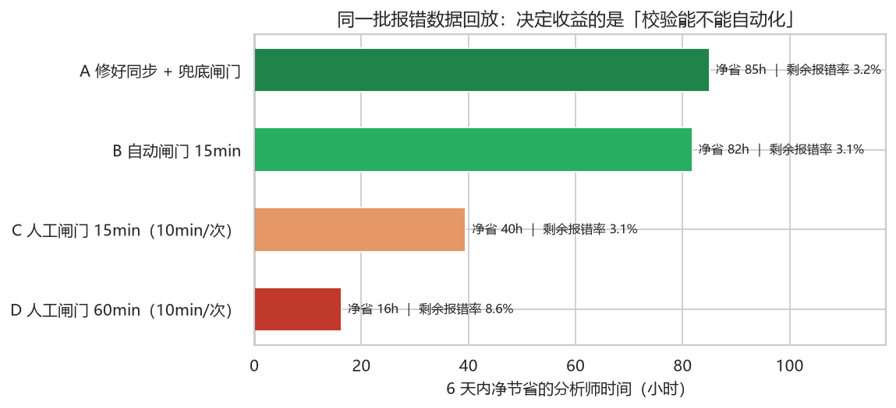
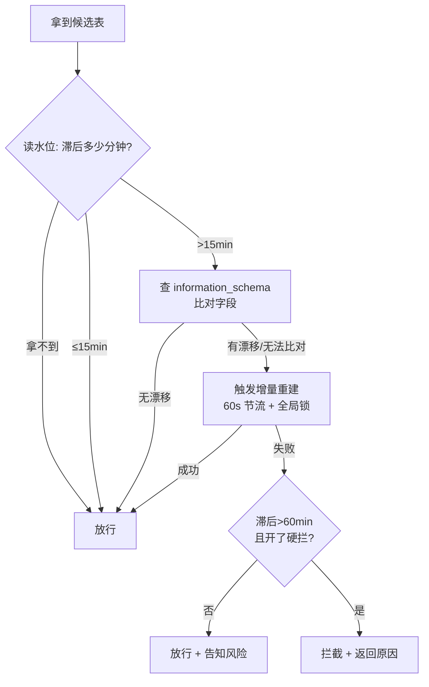

# 问穹 · SQL 问数报错治理

> **业务目标**：减少业务分析师因大模型生成的 SQL 执行报错而损失的等待与排查时间
> **数据**：`data/sql_queries.csv`，2026-09-01 ~ 09-07，原始 1025 行 / 去重后 976 条查询
> **口径**：单次执行报错损失 75 分钟；单次前置校验花费 10 分钟
> **详细报告**：[`reports/问题定位分析.md`](reports/问题定位分析.md)｜[`reports/解决方案.md`](reports/解决方案.md)

---

## 结论先行

**报错不是随机的，也不是"模型能力不行"这么笼统。数据里只有一个强信号：生成 SQL 时依据的元数据快照已经陈旧。**

28.8% 的查询落在快照滞后 > 15 分钟的窗口里，却贡献了 **78.6% 的报错**（96.2 / 122.5 小时）。
一旦快照新鲜，整体报错率只有 **3.2%**，此时"提示词长短、部门、置信分"全部拉平。

对应的治理动作三件：**修同步（治本）→ 生成前秒级闸门（兜底）→ 报错分类快速归因（残余）**。
按真实数据回放，6 天内可把损失从 **122.5 小时压到 36.9 小时，净省 85.6 小时（≈100 小时/周）**。

---

# 一、问题定位

## 1. 先对齐口径：数据里有三个坑

| # | 坑 | 影响 |
|---|---|---|
| 1 | 1025 行里 **49 个 query_id 各被记录了两次**（47 组成功、2 组为空） | 不去重会把报错率从 **10.57%** 稀释成 9.95%，损失少算 3 次 |
| 2 | `query_time` 是 `+08:00`，`schema_synced_at` 是 `Z`（UTC） | 直接相减会得到"所有查询都滞后 8 小时"的假结论 |
| 3 | 51 行 `exec_success` 为空（去重后 49 行，占 5%） | 若中断同样让分析师干等，损失从 122.5h 变 184h |

去重后：976 条 = 成功 829 + 报错 98 + 中断 49，**报错率 98/927 = 10.6%**。

## 2. 主因：元数据快照陈旧


| 快照滞后 | 0–6分 | 6–15分 | 15–30分 | 30–45分 | 45–60分 | >60分 |
|---|---|---|---|---|---|---|
| 查询数 | 344 | 316 | 70 | 83 | 79 | 35 |
| 报错率 | **2.6%** | **3.8%** | 21.4% | 32.5% | 20.3% | **54.3%** |

- 相关系数 r = **0.380**（p < 0.001），是全部字段里唯一有量级的信号；
- 拐点很清楚：15 分钟以内几乎不出事，一过 15 分钟跳到 20%+，超过 1 小时过半报错；
- 与问穹的链路对得上：`meta` 库 → 向量/全文索引 → 智能体检索表字段 → 生成 SQL → 执行。
  字典落后于物理数仓，检索到的是旧表结构，SQL 在执行阶段因列不存在/类型不匹配而报错。
- 同步节奏本身也印证：7 天 909 个快照版本，正常约 5 分钟一版；白天出现 48 分钟（09-02 17:35）
  和 36 分钟（09-05 08:38）断档。

## 3. 被数据否定的四个"显眼"假设

| 假设 | 数据结论 | 判定 |
|---|---|---|
| 置信分低 → 报错多 | r = **-0.020**，p = 0.55；分桶 11.2% → 9.7% 无单调性；8 个域内逐一检验都不显著 | **无关，干扰项** |
| 提问越复杂越容易错 | 边际上 6.4% → 13.5%，但**只看快照新鲜时长/短提示都是 3.2%**；提示词长度与滞后相关 r=0.196 | **混杂假象** |
| 某些部门用得烂 | 部门整体 4.9%~14.7%，但分层后真相是**暴露度不同** | **不是部门主效应** |
| 某些域/时段集中爆发 | 主题域 p=0.74、时段 p=0.46；±10 分钟内连环报错的观测/期望 = **0.92 倍** | **无此现象** |


| 部门 | 快照新鲜 | 快照陈旧 |
|---|---|---|
| 营销增长部 | 3.9% | **38.1%** |
| 供应链业务部 | 4.6% | **36.7%** |
| 财务风控部 | 0.0% | **32.8%** |
| 零售业务部 | 4.3% | **6.2%** |

零售业务部几乎是免疫的——它查的表结构基本不变。这条观察直接决定了方案里闸门要**比对结构**而不是无脑重建。


## 4. 损失分布：大头在 15 分钟到 1 小时这段

| 情境 | 报错数 | 损失 | 占比 |
|---|---|---|---|
| 快照滞后 > 1h | 19 | 23.8h | 19.4% |
| 快照滞后 15min–1h | **58** | **72.5h** | **59.2%** |
| 快照新鲜 | 21 | 26.3h | 21.4% |

合计 98 次 × 75 分钟 = **122.5 小时 ≈ 15.3 人日**。

## 5. 还有 21% 没解释

- 快照新鲜时仍报错 **21 次（3.2%）**：置信分中位 10 vs 成功组 16，方向对但样本太少；
  没有错误码、失败 SQL、涉及表字段，无法继续定位。
- **中断 49 次（5.0%）**：快照滞后正常，与报错不同源，更像回传超时；仓储物流域偏高（+9.1pp）。

---

# 二、解决方案

## 1. 三层，按性价比排序

| 优先级 | 动作 | 解决什么 | 6 天净收益 |
|---|---|---|---|
| **P0** | 元数据同步改造：事件驱动增量 + 5 分钟兜底 + 断档告警 + 水位落库 | 从源头消掉 78.6% 的报错 | **+85.6h**（≈100h/周）|
| **P1** | 生成前闸门：秒级结构比对 → 只在真漂移时重建 → 兜底可拦截 | P0 仍偶发断档时的保险 | 独立 **+81.8h**；与 P0 叠加几乎零成本 |
| **P2** | 执行报错六分类 + 一次自动纠正 + 可读摘要 | 残余 3.2% 不再吃 75 分钟盲查 | 需上线实测，估 15~20h |

**关键判断：收益来自"校验能不能自动化"，不是阈值调得多细。**

| 做法 | 净节省 | 剩余报错率 |
|---|---|---|
| 修好同步 + 兜底闸门 | 85.0h | 3.17% |
| **自动**闸门 15min（秒级刷新，0.5 min/次） | **81.8h** | 3.14% |
| **人工**闸门 15min（10 min/次） | 39.5h | 3.14% |
| 人工闸门 60min（10 min/次） | 16.3h | 8.64% |

任务书给的"校验 10 分钟/次"是人工口径，照字面做成让分析师手动校验，85 小时的收益会被吃掉一半。



## 2. P0：同步改造（治本）

1. **触发方式**：数仓 DDL / 调度事件 → 只重建变更表（增量），不再依赖人工；
2. **兜底**：`*/5` 全量对齐，失败重试；
3. **水位落库**：每次成功同步写 `meta_sync_state`，对外暴露 `schema_lag_seconds`（P99 ≤ 300s）
   与 `sync_gap_over_10min_total`（应恒为 0）。

> 顺带修了一个真 bug：`build_meta_knowledge.py` 原来写的是 `from Lib import argparse`，
> 项目里没有 `Lib` 包，脚本一 import 就崩。说明元数据重建很可能一直是人工在别处跑——
> 这与"同步会断档、断档就报错"正好对上。

## 3. P1：生成前闸门（已实现）

卡在 `add_extra_context` 之后、`generate_sql` 之前：此时候选表已确定，可以只对这几张表做一次
`information_schema` 秒级比对，而不是盲重建。



| 快照滞后 | 结构比对 | 重建 | 动作 |
|---|---|---|---|
| ≤15min | — | — | 放行 |
| >15min | 无漂移 | — | **放行**（字典旧但结构没变，风险等同基线）|
| >15min | 有漂移/无法比对 | 成功 | 放行（已重建）|
| >15min | 有漂移/无法比对 | 失败，≤60min | 放行 + 告知 |
| >60min | 有漂移/无法比对 | 失败 | 拦截（需开开关）|

阈值走环境变量，灰度期不用发版：`SCHEMA_WARN_MINUTES=15`、`SCHEMA_BLOCK_MINUTES=60`、
`SCHEMA_BLOCK_ON_STALE=false`（**默认只告警不拦**，等误拦率验证后再开）。

代码落点：

| 文件 | 类型 | 作用 |
|---|---|---|
| `data-lx-agent/app/agent/policy.py` | 新增 | 纯函数策略 + 报错分类，零依赖，自带自测 |
| `data-lx-agent/app/agent/nodes/ensure_schema_fresh.py` | 新增 | 闸门节点，异常一律放行 |
| `data-lx-agent/app/services/schema_guard_service.py` | 新增 | 秒级比对 + TTL/锁重建 |
| `data-lx-agent/app/models/mysql/meta_sync_state_mysql.py`<br>`data-lx-agent/docker/mysql/meta_sync_state.sql` | 新增 | 水位表 ORM + DDL |
| `app/repositories/mysql/{meta,dw}_mysql_repository.py` | 修改 | 读水位 / 写水位 / 读活库字段 |
| `app/agent/{graph,state}.py` | 修改 | 接图、新增 3 个状态字段 |
| `app/scripts/build_meta_knowledge.py` | 修改 | 修 ImportError + 同步成功写水位 |

## 4. P2：报错快速归因

现状 `execute_sql` 直接 `raise`，分析师只拿到一句报错，这就是 75 分钟的来源。
`policy.classify_sql_error()` 已把报错分成六类：

| 类别 | 典型信息 | 处理 |
|---|---|---|
| `metadata` | Unknown column / Table doesn't exist | **重建元数据 + 让模型改一版** |
| `syntax` / `type` | 语法错 / 值域类型不匹配 | 让模型改一版（最多一次）|
| `permission` / `timeout` | 权限 / 锁超时 | 改 SQL 没用，直接给人话结论 |

接线只需让 `execute_sql` 把错误写回 `state["error"]`，复用现成的 `validate_sql → correct_sql` 条件边，
再加一个 `sql_retried` 计数防死循环。**这部分没直接改**：动的是主链路，必须先在起了 Docker 的环境回归。

## 5. 收益回放（对 976 条真实查询）

| 方案 | 触发 | 校验成本 | 剩余报错 | 总损失 | 净节省 |
|---|---|---|---|---|---|
| 现状 | 0 | 0.0h | 98.0 | 122.5h | — |
| A 修好同步 | 0 | 0.0h | 29.5 | 36.9h | **+85.6h** |
| B 自动闸门 15min（p=95%） | 267 | 4.4h | 29.1 | 36.3h | **+81.8h** |
| C 人工闸门 15min（p=95%） | 267 | 46.7h | 29.1 | 36.3h | +39.5h |
| D 人工闸门 60min（p=95%） | 35 | 6.2h | 80.1 | 100.1h | +16.3h |
| E A + 兜底闸门（5% 残留） | 46 | 0.8h | 29.4 | 36.8h | **+85.0h** |

敏感性上，15 分钟在刷新成功率 p=60%~100% 之间都稳（+69.8 ~ +83.4h），不是靠调参调出来的；
30 分钟以上明显掉收益，因为漏掉了"15~30 分钟"这段占损失大头的窗口（58 次 / 72.5h）。

分部门阈值也不必一刀切：供应链 6min、营销 15min、财务 15min、零售 60min（它对陈旧免疫）。

## 6. 验证与验收

| 步骤 | 做法 |
|---|---|
| 离线回放 | `python -m src.simulate_gate`，改参数自己看净收益 |
| 端到端 | 改 `meta_sync_state` 造陈旧 + `ALTER TABLE` 改列名，验证“触发重建”与“无漂移不重建”两条分支 |
| 灰度 | 先 `SCHEMA_BLOCK_ON_STALE=false` 跑 3 天，再按部门开硬拦（零售最后开）|

| 验收指标 | 目标 |
|---|---|
| 整体报错率 | ≤ 3.5%（现状 10.6%）|
| 净节省 | ≥ 90h/周 |
| 闸门自身开销 P99 | ≤ 50ms（不含重建）|
| 误拦率（拦截后重试即成功）| ≤ 1% |

## 7. 风险与兜底

| 风险 | 兜底 |
|---|---|
| 重建把机器打满 | 60s TTL + 全局锁 + 30s 超时 + 子进程隔离 |
| 闸门误伤正常查询 | 默认只告警；`information_schema` 权限缺失时降级为放行 |
| 阈值过拟合（仅 6 天数据）| 15min 在敏感性分析中稳健；上线后按 7 日滚动重算 |
| 中断 49 次仍无解释 | 先补回传超时埋点；若中断也计 75min，损失变 184h，优先级上调 |

---

# 三、复现

```bash
# 数据体检
python -m src.profile data/sql_queries.csv --figures

# 六阶段定位分析
python -m src.analyze_queries
python -m src.dig_queries2      # 3/4/5 同理

# 方案收益回放
python -m src.simulate_gate

# 闸门策略自测（零依赖，不需要起服务）
python data-lx-agent/app/agent/policy.py

# 生成结论图
python -m src.make_figures && python -m src.make_solution_figure
```

环境：Python 3.13，`pip install -i https://pypi.org/simple -r requirements.txt`
（后端 `data-lx-agent` 另用自己的 `uv` 环境，两者互不干扰）。

---

# 四、仓库结构

| 目录 | 内容 |
|---|---|
| `src/` | 分析脚本：数据体检、六阶段定位、收益回放、图表 |
| `reports/` | 诊断报告、方案文档、图表 |
| `data-lx-agent/` | 问穹后端：FastAPI + LangGraph 的 NL2SQL 智能体（含本次改动）|
| `date-lx-agent-frontend/` | 问穹前端：Vue 3 + Vite |
| `notebooks/` | 探索性分析 |

---

# 五、交付边界

**已做**：六阶段定位分析、方案设计与收益回放、闸门策略与节点实现、水位表与 repository 方法、
graph 接入、`build_meta_knowledge` 的 ImportError 修复、策略自测 11 个用例。

**没做**：`execute_sql` 错误分类接线（需环境回归）、前端提示文案、线上灰度。
所有收益均为**离线回放**，不是线上实测。
