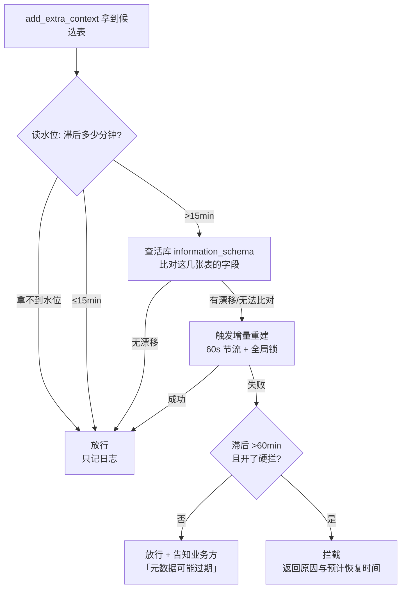

# 解决方案：把「元数据陈旧」这条链路掐断

> 依据：[`问题定位分析.md`](问题定位分析.md) —— 28.8% 的查询落在快照滞后 >15 分钟的窗口，
> 贡献了 78.6% 的报错；滞后 >1 小时报错率 54.3%，而新鲜窗口只有 3.2%。
> 本方案所有收益数字都来自 [`src/simulate_gate.py`](../src/simulate_gate.py) 对 976 条真实查询的回放。

---

## 0. 一页结论

**做三件事，按性价比排序。核心不是"加个拦截"，而是"把拦截动作自动化 + 把源头修好"。**

| 优先级 | 动作 | 解决什么 | 6 天净收益 |
|---|---|---|---|
| **P0** | 元数据同步改造：事件驱动增量 + 5 分钟兜底 + 断档告警 + 水位落库 | 从源头消掉 78.6% 的报错 | **+85.6 h**（≈100 h/周）|
| **P1** | 生成前闸门：秒级结构比对 → 只在真漂移时重建 → 兜底可拦截 | P0 仍偶发断档时的保险 | 独立实施 **+81.8 h**；与 P0 叠加 ≈ +85 h，成本几乎为 0 |
| **P2** | 执行报错分类 + 一次自动纠正 + 可读错误摘要 | 让残余 3.2% 的报错不再吃 75 分钟盲查 | 需上线实测，按残余 29 次/6 天估 15~20 h |

**一个关键判断：收益来自"校验能不能自动化"，不是阈值调得多细。**

| 方案 | 净节省 | 剩余报错率 |
|---|---|---|
| 修好同步 + 兜底闸门 | 85.0 h | 3.17% |
| 自动闸门 15min（秒级刷新，0.5 min/次） | 81.8 h | 3.14% |
| 人工闸门 15min（10 min/次） | 39.5 h | 3.14% |
| 人工闸门 60min（10 min/次） | 16.3 h | 8.64% |

同一套判据、同样的拦截效果，**人工校验把 85 小时的收益吃掉一半**。所以方案里所有"校验"都做成系统内秒级动作，只有系统自己搞不定时才升级到人。


---

## 1. 从现象到动作：每一条诊断对应一个改动

| 诊断结论 | 对应动作 | 落在哪 |
|---|---|---|
| 快照滞后 >15min 贡献 78.6% 报错 | P0 同步改造 + P1 生成前闸门 | `build_meta_knowledge` / 新增闸门节点 |
| 白天出现 48 分钟、36 分钟断档 | 断档 >10 分钟告警 + 5 分钟兜底调度 | 调度侧（见 §2） |
| 零售业务部在陈旧窗口只 6.2% 报错 | 闸门比对**活库表结构**而不是无脑重建：结构没变就放行 | `schema_guard_service.check()` |
| `confidence_score` 与报错无关（r=-0.02） | **不**用置信分做阈值 | 明确排除 |
| 提示词长度是混杂假象 | **不**按长度拦截 | 明确排除 |
| 新鲜快照下仍有 21 次报错 | P2 报错分类 + 一次自动纠正 | `execute_sql` 改造（见 §4）|
| 49 次「执行中断」自成一体 | 先补埋点（回传超时/超时重试），本期不做 | 见 §7 |

### 为什么不用置信分做闸门（最容易被想到、但数据不支持）

若以 `confidence_score <= 10` 为线拦截：命中 317 条（34.2%），其中真报错 38 条，**精确率 12.0%**；
而全量报错率本来就是 10.57%。也就是说这个规则只比"随便拦"好 1.4 个百分点，
却要打扰三分之一的业务提问，还只能覆盖 38.8% 的报错。**收益为负，直接排除。**

---

## 2. P0：元数据同步改造（治本）

### 现状（来自数据）

- 7 天出现 909 个快照版本，相邻两版间隔中位 **5 分钟**，说明正常节奏是分钟级；
- 白天有两次长断档：09-02 17:35→18:23（48 分钟）、09-05 08:38→09:14（36 分钟）；
- 夜间 21:40→次日 06:20 停更（夜间无查询，可接受）。

### 顺带发现一个"为什么断档"的线索

`app/scripts/build_meta_knowledge.py` 里原来写的是 `from Lib import argparse`，而项目里并没有 `Lib` 这个包
—— 这个脚本在当前仓库状态下**一 import 就报错**。也就是说元数据重建很可能从来不是自动调度跑的，
而是人工在另一份副本上执行。这与"同步会断档、断档就报错"的现象是自洽的。
本次已改成 `import argparse`（改动见 §3 表格）。

### 三条改动

1. **触发方式**：数仓 DDL / 调度平台事件 → 只重建变更的表（增量），不再依赖人工；
2. **兜底**：`*/5 * * * *` 跑一次全量对齐，任何一次失败都要重试；
3. **水位落库**：每次成功同步写 `meta_sync_state`（本仓库已加 DDL + ORM + repository 方法），
   并提供两个监控指标：
   - `schema_lag_seconds`（P99 应 ≤ 300）
   - `sync_gap_over_10min_total`（应恒为 0，>0 立即告警）

### 验收

| 指标 | 目标 |
|---|---|
| `schema_lag_seconds` P99 | ≤ 300 s |
| 白天（07:00-22:00）断档 >10min 次数 | 0 |
| 重建耗时 P95 | ≤ 60 s |

---

## 3. P1：生成前闸门（已实现，可直接跑）

### 为什么卡在 `generate_sql` 之前

闸门放在 `add_extra_context` 之后、`generate_sql` 之前：此时 `table_infos` 已经确定，
可以**只对这次要查的几张表**做比对，一次 `information_schema` 查询足够，秒级。
放在最前面反而做不了窄化比对，只能盲重建。

### 决策流程



### 决策表

| 快照滞后 | 结构比对 | 重建结果 | 动作 |
|---|---|---|---|
| ≤ 15 min | — | — | 放行 |
| > 15 min | 无漂移 | — | **放行**（字典旧但结构没变，风险等同基线）|
| > 15 min | 有漂移 / 无法比对 | 成功 | 放行（已重建）|
| > 15 min | 有漂移 / 无法比对 | 失败，lag ≤ 60 min | 放行 + 告知 |
| > 60 min | 有漂移 / 无法比对 | 失败 | 拦截（需开开关）|

### 配置开关（环境变量，灰度期不用改代码发版）

| 变量 | 默认 | 说明 |
|---|---|---|
| `SCHEMA_WARN_MINUTES` | 15 | 超过即触发比对 |
| `SCHEMA_BLOCK_MINUTES` | 60 | 超过且重建失败才考虑硬拦 |
| `SCHEMA_BLOCK_ON_STALE` | `false` | **默认只告警不拦截**，等误拦率验证后再开 |

### 代码落点

| 文件 | 类型 | 作用 |
|---|---|---|
| `app/agent/policy.py` | 新增 | 纯函数策略 `evaluate()` / `diff_schema()` + 报错归类，自带自测（`python app/agent/policy.py`）|
| `app/agent/nodes/ensure_schema_fresh.py` | 新增 | 闸门节点，接入 LangGraph |
| `app/services/schema_guard_service.py` | 新增 | 秒级比对 + 带 TTL/锁的重建 |
| `app/models/mysql/meta_sync_state_mysql.py` | 新增 | 水位表 ORM |
| `docker/mysql/meta_sync_state.sql` | 新增 | 水位表 DDL（新容器自动导入）|
| `app/repositories/mysql/meta_mysql_repository.py` | 修改 | `get_schema_lag_minutes()` / `mark_schema_synced()` |
| `app/repositories/mysql/dw_mysql_repository.py` | 修改 | `get_live_columns()`：一次 `information_schema` 查询 |
| `app/agent/state.py` | 修改 | 新增 `schema_lag_minutes` / `schema_status` / `blocked_reason` |
| `app/agent/graph.py` | 修改 | `START → ensure_schema_fresh →（条件边）extract_keywords` |
| `app/scripts/build_meta_knowledge.py` | 修改 | 修 `from Lib import argparse` 的 ImportError；构建成功写水位 |

**设计原则写死在代码里**：闸门自身任何异常都放行（`except → schema_status="error"`），
不允许因为校验组件出问题而影响取数主流程。

---

## 4. P2：执行报错快速归因（设计已给，代码待接）

现状是 `execute_sql` 直接 `raise`，异常一路抛到 SSE，分析师只拿到一句报错，
没有归类、没有重试，只能自己去看 SQL —— 这就是 75 分钟的来源。

`policy.classify_sql_error()` 已把报错分成 6 类，并给出是否值得重试：

| 类别 | 典型信息 | 处理 |
|---|---|---|
| `metadata` | Unknown column / Table doesn't exist | **重建元数据 + 让模型改一版**（最该重试）|
| `syntax` / `type` | 语法错误 / 值域类型不匹配 | 让模型改一版（最多一次）|
| `permission` / `timeout` | 权限 / 锁超时 | 改 SQL 没用，直接给人话结论 |

接线只需把 `execute_sql` 改成不抛异常、把错误写回 `state["error"]`，再复用现成的
`validate_sql → correct_sql` 条件边（加一个 `sql_retried` 计数防死循环）。
**这部分没直接改**：它动的是现有主链路，必须先在起了 Docker 的环境里回归，见 §6。

---

## 5. 收益测算（真实回放，不是拍脑袋）

口径：报错 75 分钟/次、校验 10 分钟/次；模型假设写在 `simulate_gate.py` 顶部，可逐条反驳。

| 方案 | 触发 | 校验成本 | 剩余报错 | 拦截未取数 | 总损失 | 净节省 |
|---|---|---|---|---|---|---|
| 现状 | 0 | 0.0 h | 98.0 | 0 | 122.5 h | — |
| A 修好同步 | 0 | 0.0 h | 29.5 | 0 | 36.9 h | **+85.6 h** |
| B 自动闸门 15min（p=95%） | 267 | 4.4 h | 29.1 | 13 | 36.3 h | **+81.8 h** |
| B- 自动闸门 15min（p=80%） | 267 | 11.1 h | 27.8 | 53 | 34.7 h | +76.7 h |
| B+ 自动闸门 30min（p=95%） | 197 | 3.3 h | 42.0 | 10 | 52.4 h | +66.7 h |
| C 人工闸门 15min（p=95%） | 267 | 46.7 h | 29.1 | 13 | 36.3 h | +39.5 h |
| D 人工闸门 60min（p=95%） | 35 | 6.2 h | 80.1 | 2 | 100.1 h | +16.3 h |
| E A + 兜底闸门（5% 残留触发） | 46 | 0.8 h | 29.4 | 2 | 36.8 h | **+85.0 h** |

**敏感性**（自动闸门，0.5 分钟/次）：

| 阈值 | p=60% | p=80% | p=95% | p=100% |
|---|---|---|---|---|
| 6 min | +53.6 | +68.3 | +79.5 | +83.2 |
| **15 min** | +69.8 | +76.7 | **+81.8** | +83.4 |
| 30 min | +58.0 | +63.1 | +66.7 | +68.0 |
| 60 min | +20.3 | +21.2 | +21.8 | +22.1 |

结论：**15 分钟这条线在 p=60%~100% 的区间里都稳**，不是靠调参调出来的；
30 分钟以上明显掉收益，因为漏掉了"15~30 分钟"这段占损失大头的窗口（58 次 / 72.5 h）。

**分部门阈值（数据支持差异化，不必一刀切）**：

| 部门 | 现状报错 | 最优阈值 | 净节省 |
|---|---|---|---|
| 供应链业务部 | 37 次 | 6 min | 32.6 h |
| 营销增长部 | 30 次 | 15 min | 26.1 h |
| 财务风控部 | 20 次 | 15 min | 24.0 h |
| 零售业务部 | 11 次 | 60 min | 2.1 h |

零售业务部对陈旧几乎免疫，收紧阈值只会增加无谓校验 —— 这也反向验证了"结构比对"这条设计的价值。

---

## 6. 验证与上线

**第一步：离线回放**（已有）

```bash
python -m src.simulate_gate      # 改参数重跑，自己看净收益
```

**第二步：端到端回归**（需 Docker）

1. `docker compose up -d`，跑 `python -m app.scripts.build_meta_knowledge -c conf/meta_config.yaml`；
2. 造陈旧场景：把 `meta_sync_state.last_synced_at` 改到 40 分钟前 + 在 dw 里 `ALTER TABLE` 改个列名；
3. 提一个问题，观察三件事：闸门是否触发重建、重建后 SQL 是否通过、`schema_status` 是否被正确写成 `refresh`；
4. 造"无漂移"场景（只改时间不改结构），确认**不触发重建**（这是省成本的关键分支）。

**第三步：灰度**

- 先 `SCHEMA_BLOCK_ON_STALE=false` 跑 3 天，只看告警与重建次数；
- 再按部门灰度开硬拦，**零售业务部最后开**；
- 一周后按真实数据重算阈值。

**验收线**

| 指标 | 目标 |
|---|---|
| 整体报错率 | ≤ 3.5%（现状 10.6%）|
| 净节省 | ≥ 90 h/周 |
| 闸门自身开销 P99 | ≤ 50 ms（不含重建）|
| 误拦率（拦截后重试即成功的比例）| ≤ 1% |
| 重建成功率 | ≥ 95% |

**需要新增的埋点**（否则下次只能继续猜）：`schema_lag_minutes`、`schema_status`、`rebuild_ms`、
`error_kind`、`sql_retried`、`time_to_result_ms`。

---

## 7. 风险与兜底

| 风险 | 兜底 |
|---|---|
| 重建把机器打满 | 60 s TTL + 全局锁 + 30 s 超时 + 子进程隔离 |
| 闸门误伤正常查询 | 默认只告警不拦截；`information_schema` 权限缺失时按"无法比对"降级为放行 |
| 阈值过拟合（只有 6 天数据）| 15 min 在敏感性分析里稳健；上线后按 7 日滚动窗口重算 |
| 重建期间索引短暂不一致 | 重建写新版本再切读，或直接沿用上一版直到成功 |
| 会话/事务污染 | 水位查询失败只返回 None，不做写操作 |
| 「中断」49 次仍无解释 | 本期先补回传超时埋点；若中断也按 75 分钟计，损失从 122.5 h 变 184 h，优先级会上调 |

---

## 8. 排期建议

| 阶段 | 内容 | 产出 / 验收 |
|---|---|---|
| 第 1 周 | P0 同步改造 + 水位落库 + 断档告警 | `schema_lag` P99 ≤ 5 min，白天断档 0 次 |
| 第 2 周 | P1 闸门灰度（只告警） | 重建次数、误伤情况可观测 |
| 第 3 周 | 开硬拦（按部门）+ P2 报错分类 | 报错率 ≤ 3.5%，净省 ≥ 90 h/周 |
| 持续 | 每周用真实数据回放重算阈值 | 阈值不腐烂 |

---

## 9. 本次交付的边界（说清楚，免得误解）

**已做**：策略与自测（11 个用例全过）、闸门节点、守卫服务、水位表 DDL/ORM、两个 repository 方法、
graph 接入、`build_meta_knowledge` 的 ImportError 修复与水位写入、收益回放脚本、本文档与配图。

**没做，需要你在有依赖的环境里补**：
1. `execute_sql` 的错误分类接线（动主链路，必须回归后再上，见 §4）；
2. 前端对"元数据可能过期 / 已拦截"的提示文案；
3. 真实灰度数据 —— 本文所有收益都是**离线回放**，不是线上实测。
