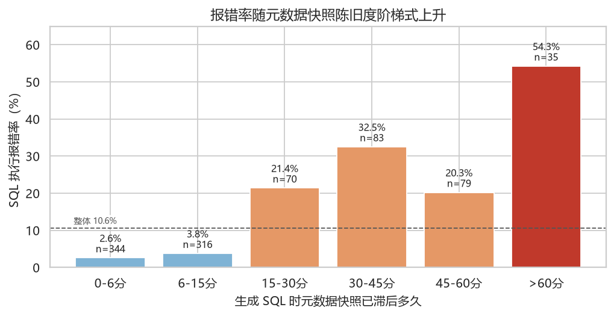
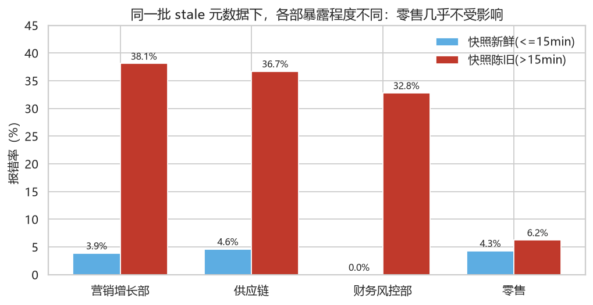
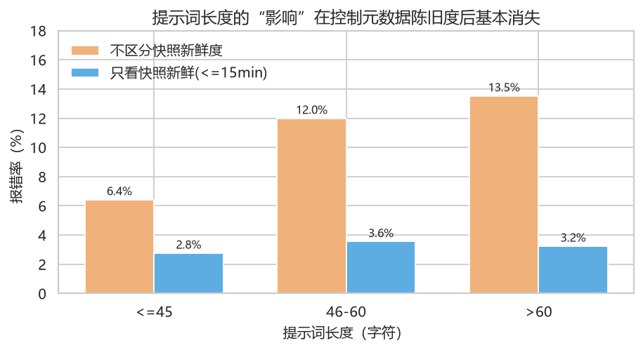
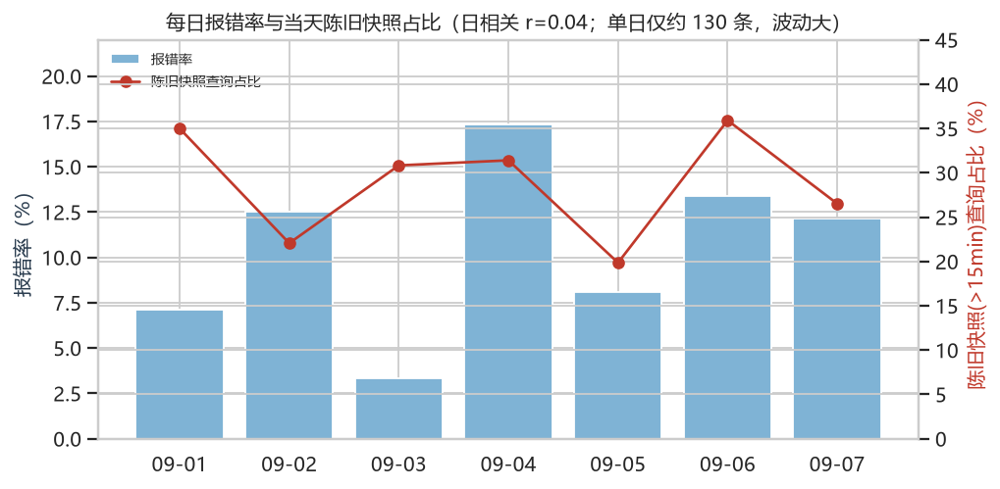

# SQL 问数报错问题定位分析

> 数据：`data/sql_queries.csv`，2026-09-01 ~ 09-07，去重后 976 条查询
> 分析脚本：`src/analyze_queries.py`、`src/dig_queries*.py`；配图：`reports/figures/`
> 阶段：**只做问题定位，不含方案**

---

## 一句话结论

报错不是随机的，也不是"大模型能力不行"这么笼统。数据里只有一个强信号：
**生成 SQL 时依据的元数据快照已经陈旧**。

28.8% 的查询发生在快照滞后 > 15 分钟的窗口里，却贡献了 **78.6% 的报错**（96.2 / 122.5 小时）。
一旦快照是新鲜的，整体报错率只有 **3.2%**，而且此时"提示词长短、部门、置信分"全都拉平。
换句话说：**问题出在"给模型看的数仓字典过时了"，不是出在"模型看不懂问题"**。

---

## 二、先把口径对齐：数据里有三个坑

| # | 坑 | 影响 |
|---|---|---|
| 1 | 1025 行里有 **49 个 query_id 各被记录了两次**（98 行），其中 47 组是成功、2 组是空 | 不去重会把报错率从 **10.57%** 稀释成 9.95%，损失少算 3 次 × 75 分钟 |
| 2 | `query_time` 是 `+08:00`，`schema_synced_at` 是 `Z`（UTC） | 直接相减会得到"所有查询都滞后 8 小时"的假结论，必须先统一时区 |
| 3 | 51 行 `exec_success` 为空（去重后 49 行，占 5.0%），口径没定义 | 若"中断"同样要让分析师干等，损失从 **122.5h 变 184h** |

去重后口径：976 条 = 成功 829 + 报错 98 + 中断 49，**报错率 98/927 = 10.6%**。

---

## 三、主因：元数据快照陈旧（唯一强信号）



| 快照滞后 | 查询数 | 报错数 | 报错率 |
|---|---|---|---|
| 0–6 分 | 344 | 9 | **2.6%** |
| 6–15 分 | 316 | 12 | **3.8%** |
| 15–30 分 | 70 | 15 | 21.4% |
| 30–45 分 | 83 | 27 | 32.5% |
| 45–60 分 | 79 | 16 | 20.3% |
| > 60 分 | 35 | 19 | **54.3%** |

- 相关系数 r = **0.380**（p < 0.001），是全部字段里唯一有量级的信号。
- 拐点很清楚：**滞后 15 分钟以内几乎不出事（2.6%→3.8%），一过 15 分钟直接跳到 20%+，超过 1 小时过半报错**。
- 这不像"慢慢变差"，更像"跨过某个节拍就翻车"。

**为什么会这样（与灵犀链路的对应关系）**

课件里的链路是：MySQL `meta` 库（表/字段/指标）→ 构建**向量索引 + 全文索引** → 智能体检索候选表字段 → 生成 SQL → 数仓执行。
`schema_synced_at` 记录的是"这份字典最后一次同步到索引的时间"。字典一旦落后于物理数仓：
检索到的是**旧表结构 / 已改名或已下线的字段**，生成的 SQL 引用的列在数仓里不存在或类型对不上，执行阶段直接报错。
这正好解释为什么报错发生在"执行"这一步，而不是"生成"这一步。

**同步节奏本身也印证了这一点**：7 天里出现 909 个快照版本，正常约 5 分钟一版；
白天出现过 48 分钟（09-02 17:35→18:23）和 36 分钟（09-05 08:38→09:14）的断档；
夜间 21:40 → 次日 06:20 停更（但夜间没有查询，影响可忽略）。

---

## 四、被数据否定的四个"显眼"假设

| 假设 | 数据结论 | 判定 |
|---|---|---|
| **置信分低 → 报错多** | r = **-0.020**，p = 0.55；分桶 0-5 分 11.2%、26-30 分 9.7%，无单调性；8 个主题域内部逐一检验也都是 \|r\| < 0.15 且不显著 | **无关，是干扰项** |
| **提问越复杂（提示词越长）→ 越容易错** | 边际上确实是 6.4% → 12.0% → 13.5%；但**只看快照新鲜时，长提示 3.2% vs 短提示 2.8%，差异消失**。且提示词长度本身与滞后相关（r = 0.196，长提示里 42% 落在陈旧窗口） | **混杂假象** |
| **某些部门用得烂** | 部门间确实有差异（供应链 14.7% / 营销 13.8% / 财务 8.7% / 零售 4.9%，p = 0.0018）；但分层后真相是**暴露度不同**，不是能力不同（见下表） | **不是部门主效应** |
| **某些主题域/时段集中爆发** | 主题域 p = 0.74、发起小时 p = 0.46，均不显著；报错在时间上也不成簇（±10 分钟内连环报错的观测/期望 = **0.92 倍**，完全随机） | **无此现象** |



| 部门 | 快照新鲜时报错率 | 快照陈旧时报错率 |
|---|---|---|
| 营销增长部 | 3.9% | **38.1%** |
| 供应链业务部 | 4.6% | **36.7%** |
| 财务风控部 | 0.0% | **32.8%** |
| 零售业务部 | 4.3% | **6.2%** |

零售业务部几乎是"免疫"的 —— 说明**它的查询所涉及的表结构基本不变**，同样的陈旧字典对它不构成伤害。
这也解释了第四节里"部门差异"的来源：不是部门的问题，是**各部门所查主题域对 schema 变更的敏感度不同**。



---

## 五、损失量化（口径：报错 75 分钟/次）

98 次报错 × 75 分钟 = **122.5 小时 ≈ 15.3 人日**。

| 情境 | 查询数 | 报错数 | 组内报错率 | 损失 | 占全部损失 |
|---|---|---|---|---|---|
| 快照滞后 > 1h | 35 | 19 | 54.3% | 23.8h | 19.4% |
| 快照滞后 15min–1h | 232 | 58 | 25.0% | **72.5h** | **59.2%** |
| 新鲜 + 长提示(>60 字) | 154 | 5 | 3.2% | 6.3h | 5.1% |
| 新鲜 + 短提示 | 506 | 16 | 3.2% | 20.0h | 16.3% |

**大头不在"极端陈旧"，而在"滞后 15 分钟到 1 小时"这一段 —— 72.5 小时，占近六成。**
这段占比高，是因为它既足够脏（报错率 25%）、量又足够大（232 条）。

顺带按给定口径做一次可行性估算（**只是算账，不是方案**）：

| 若对高滞后查询做前置校验（10 分钟/次） | 校验成本 | 挽回损失 | 净收益 |
|---|---|---|---|
| 阈值 > 1h（35 次） | 5.8h | 23.8h | **+17.9h** |
| 阈值 > 15min（267 次） | 44.5h | 96.2h | **+51.8h** |



---

## 六、还有 21% 没解释：数据缺口在这里

| 未解释部分 | 规模 | 观察 |
|---|---|---|
| 快照新鲜时仍然报错 | 21 次（3.2%） | 置信分中位数 10 vs 成功组 16 —— 方向对但样本太少；**没有错误类型、失败 SQL、涉及的表/字段，无法再往下定位** |
| 执行中断/未回传 | 49 次（5.0%） | 快照滞后正常（中位 9 分钟），和报错机制不同源；更像回传超时或任务被中断，仓储物流域偏高（+9.1pp） |

现有 8 个字段的天花板就在这里：**能定位到"什么时候"和"哪个部门"，定位不到"哪一类 SQL 错了"**。
如果后续要收窄，最值钱的三条埋点是：错误码/错误类型、失败 SQL 原文、SQL 涉及的表与字段。

---

## 七、留给你拍板的三个判断点

1. **15 分钟这条线是"同步节拍"还是"业务容忍线"？** 决定后面把拦截画在 15 分钟还是 1 小时 —— 两者净收益差 34 小时。
2. **"中断"算不算损失？** 算的话分母要从 98 次变 147 次，损失从 122.5h 变 184h，问题优先级会更高。
3. **有没有 SQL 错误日志可以对齐？** 有的话能直接验证"列/表不存在"这类错误在 98 次里占多少 —— 那是对"元数据陈旧"这条结论最硬的验证。

---

## 附：可复现的分析命令

```bash
python -m src.analyze_queries   # 一阶段：总览 + 各维度 × 报错率
python -m src.dig_queries      # 二阶段：重复行、滞后集中度、置信分是否被掩盖、卡方
python -m src.dig_queries2     # 三阶段：成簇检验、分天波动、部门分层、滞后形状
python -m src.dig_queries3     # 四阶段：覆盖率×精确率、损失归因、残余分析
python -m src.dig_queries4     # 五阶段：混杂验证、同步节奏、时段对应
python -m src.dig_queries5     # 六阶段：滞后×部门交互、最终拆解
python -m src.make_figures     # 生成上述 4 张图
```
